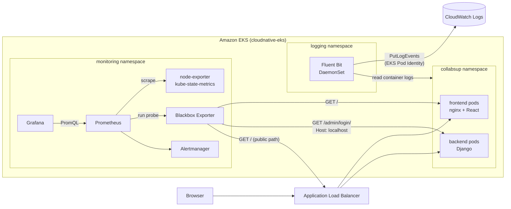
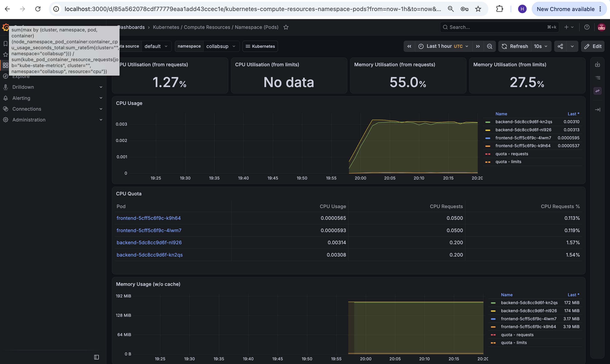
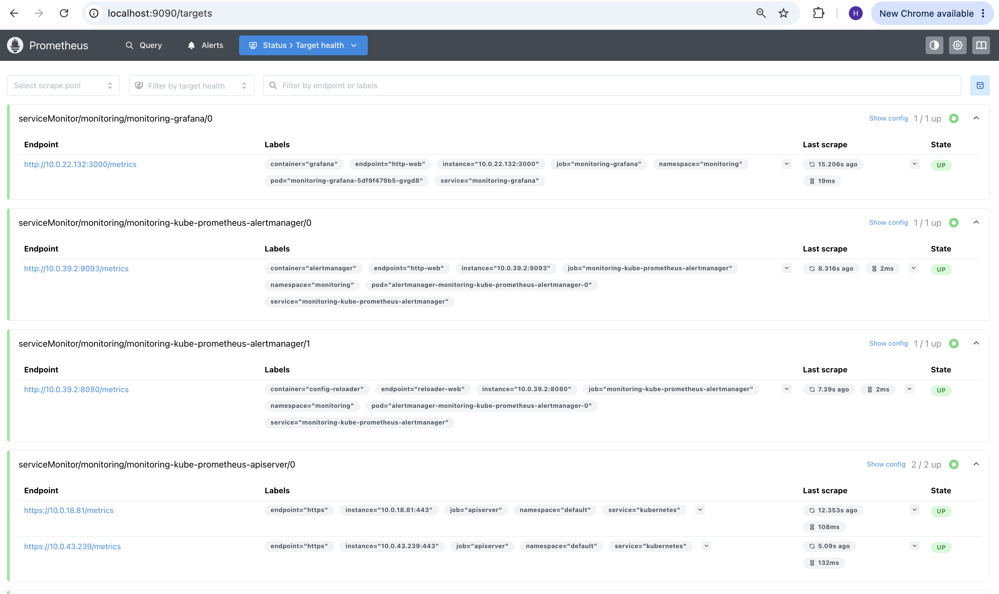
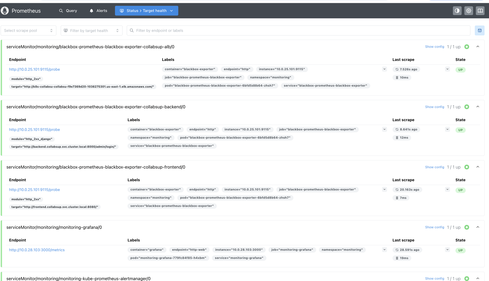
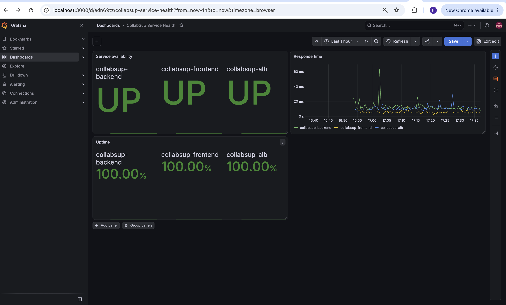

# EKS Observability Platform

Metrics, availability checks, dashboards and centralized logging for a Django/React application running on Amazon EKS.

This project adds observability to the CollabSup application deployed by my [Cloud-Native CI/CD Platform on Amazon EKS](https://github.com/HassanTaiwo185/aws-eks-self-healing-cicd-platform). It is a separate repository on purpose: the platform repo is not modified, and the whole stack installs on top of the running cluster with one script.

**Stack:** Prometheus · Grafana · Alertmanager · Blackbox Exporter · Fluent Bit · Amazon CloudWatch Logs · EKS Pod Identity · Kubernetes · Amazon EKS · Helm · Bash

---

## What it covers

| Signal | Tool | What you get |
|---|---|---|
| **Metrics** | Prometheus, node-exporter, kube-state-metrics, cAdvisor | CPU and memory per pod and node, restarts, replica counts |
| **Availability and latency** | Blackbox Exporter | Up/down status and response time for the frontend, the backend and the public load balancer, checked every 30 seconds |
| **Dashboards** | Grafana | Built-in Kubernetes dashboards plus a custom *CollabSup Service Health* dashboard, stored as code |
| **Logs** | Fluent Bit → CloudWatch Logs | Every container's logs, one log group per namespace and one stream per container |

---

## Architecture



---

## Repository structure

```
.
├── helm/
│   ├── kube-prometheus-stack-values.yaml   # Prometheus, Grafana, Alertmanager settings
│   ├── blackbox-exporter-values.yaml       # probe modules and the three targets
│   └── fluent-bit-values.yaml              # CloudWatch Logs output
├── dashboards/
│   └── collabsup-service-health.json       # Grafana dashboard as code (classic JSON)
├── iam/
│   ├── fluent-bit-trust-policy.json        # who can use the role (EKS Pod Identity only)
│   └── fluent-bit-logs-policy.json         # what the role can do (write logs to one path)
├── scripts/
│   └── install-monitoring.sh               # installs everything; safe to re-run
└── docs/screenshots/
```

---

## How it works

### Metrics

[kube-prometheus-stack](https://github.com/prometheus-community/helm-charts/tree/main/charts/kube-prometheus-stack) installs Prometheus, Grafana, Alertmanager, node-exporter and kube-state-metrics in one Helm release. Prometheus scrapes every target every 30 seconds.

Settings changed from the chart defaults, and why:

- **Control-plane scrapers disabled** (`kubeControllerManager`, `kubeScheduler`, `kubeEtcd`, `kubeProxy`). AWS runs the EKS control plane and does not expose these endpoints, so leaving them on produces permanent "target down" alerts.
- **ServiceMonitor discovery opened to all namespaces** (`*SelectorNilUsesHelmValues: false`), so the Blackbox checks are picked up without extra labels.
- **2-day retention and no persistent volume.** The cluster has no EBS CSI driver and is rebuilt every session, so in-pod storage is enough.

### Availability and latency

The application has no metrics endpoint, and the platform repo is not modified, so the app is tested from the outside the way a user would. Blackbox Exporter makes HTTP requests on Prometheus's behalf and reports:

- `probe_success`: 1 if the request returned 2xx, 0 otherwise (**availability**)
- `probe_duration_seconds`: how long the request took (**latency**)

Three layers are checked, so a failure can be located:

| Check | URL | If only this fails |
|---|---|---|
| `collabsup-frontend` | `frontend.collabsup.svc:8080/` | The frontend pods are unhealthy |
| `collabsup-backend` | `backend.collabsup.svc:8000/admin/login/` | Django is down or erroring |
| `collabsup-alb` | The public ALB address | Users cannot reach the site, but the app itself is healthy, so look at the load balancer or network |

### Dashboard as code

The *CollabSup Service Health* dashboard has three panels:

| Panel | Query |
|---|---|
| Service availability (UP/DOWN) | `probe_success{target=~"collabsup-.*"}` |
| Response time | `probe_duration_seconds{target=~"collabsup-.*"}` |
| Uptime % over the selected range | `avg_over_time(probe_success{target=~"collabsup-.*"}[$__range]) * 100` |

Uptime thresholds: green at 99.9% and above, orange from 99%, red below 99%.

Grafana has no persistent storage, so a dashboard created in the UI disappears when the cluster is rebuilt. The install script loads every file in `dashboards/` into a ConfigMap labeled `grafana_dashboard=1`, and Grafana's sidecar imports it automatically. The JSON in Git is the source of truth.

### Logs

Fluent Bit runs as a DaemonSet (one pod per node), reads every container's log files and sends them to CloudWatch Logs:

- One log group per namespace, e.g. `/eks/cloudnative-eks/collabsup`
- One log stream per container, e.g. `backend-5dc8cc9d6f-kn2qs.backend`
- 7-day retention, so old logs delete themselves

**Permissions use EKS Pod Identity, with no access keys in the cluster.** A Pod Identity association links the `fluent-bit` service account in the `logging` namespace to the IAM role `cloudnative-fluent-bit`. That role can only create and write to log groups under `/eks/cloudnative-eks/`.

---

## Setup

### Prerequisites

- The [platform](https://github.com/HassanTaiwo185/aws-eks-self-healing-cicd-platform) deployed, with CollabSup running in the `collabsup` namespace
- `kubectl` connected to the cluster (`aws eks update-kubeconfig --region us-east-1 --name cloudnative-eks`)
- `helm` and the `aws` CLI

### One-time: IAM role for Fluent Bit

The role is not tied to the cluster, so it survives `terraform destroy` and only needs creating once.

```bash
aws iam create-role --role-name cloudnative-fluent-bit \
  --assume-role-policy-document file://iam/fluent-bit-trust-policy.json

aws iam put-role-policy --role-name cloudnative-fluent-bit \
  --policy-name cloudwatch-logs-write \
  --policy-document file://iam/fluent-bit-logs-policy.json
```

The IAM user running the install script also needs permission to pass this role to EKS Pod Identity:

```json
{
  "Effect": "Allow",
  "Action": "iam:PassRole",
  "Resource": "arn:aws:iam::*:role/cloudnative-*",
  "Condition": { "StringEquals": { "iam:PassedToService": "pods.eks.amazonaws.com" } }
}
```

### Every session

1. Update the ALB address in `helm/blackbox-exporter-values.yaml` (it changes on every rebuild):
   ```bash
   kubectl get ingress -n collabsup
   ```
2. Install or update everything:
   ```bash
   ./scripts/install-monitoring.sh
   ```

The script is idempotent. It installs or upgrades the three Helm releases, loads the dashboards, and creates the Pod Identity association only if it does not already exist (the association is deleted with the cluster).

### Open Grafana and Prometheus

```bash
# Grafana admin password
kubectl get secret monitoring-grafana -n monitoring \
  -o jsonpath='{.data.admin-password}' | base64 -d; echo

# Grafana at http://localhost:3000 (user: admin)
kubectl port-forward svc/monitoring-grafana -n monitoring 3000:80

# Prometheus at http://localhost:9090
kubectl port-forward svc/monitoring-kube-prometheus-prometheus -n monitoring 9090:9090
```

Nothing is exposed to the internet; both are reached through private port-forwards.

### Query the logs

In **CloudWatch → Logs Insights**, select `/eks/cloudnative-eks/collabsup` and run:

```
fields @timestamp, kubernetes.pod_name, log
| filter kubernetes.container_name = "backend"
| sort @timestamp desc
| limit 20
```

---

## Observed baseline

Measured with the application idle, useful as a reference for "normal":

| Measurement | Value |
|---|---|
| Frontend response time (in cluster) | ~5 ms |
| Backend response time (in cluster) | ~11–26 ms |
| Response time through the ALB | ~10 ms |
| Backend memory per pod | ~172 MiB |
| Frontend memory per pod | ~3 MiB |
| Backend CPU per pod | ~0.003 cores (about 1.5% of its 0.2-core request) |

---

## Challenges and lessons learned

| Problem | Cause | Fix |
|---|---|---|
| Backend probe would return 400 instead of 200 | Django rejects requests whose `Host` is not in `ALLOWED_HOSTS`, and the internal service name is not listed | The backend probe module sends `Host: localhost`. Caught by testing with `curl` from a temporary pod before configuring the probe |
| Permanent "target down" alerts expected on EKS | The chart scrapes control-plane components that AWS does not expose | Disabled those scrapers in the values file |
| `AccessDenied` on `iam:PassRole` when creating the Pod Identity association | Handing a role to an AWS service requires `iam:PassRole`, which prevents privilege escalation | Granted `PassRole` only for `cloudnative-*` roles and only to `pods.eks.amazonaws.com` |
| Dashboards lost on every rebuild | Grafana runs without persistent storage | Exported the dashboard as JSON and load it through the Grafana sidecar |
| Exported dashboard did not match the sidecar's expected format | The newer Grafana editor exports a `v2` resource by default | Re-exported in **Classic** format and reset `id` to `null` |
| Fluent Bit's default log group was outside the IAM policy | The chart defaults to `/aws/eks/fluentbit-cloudwatch/logs` | Pointed it at `/eks/cloudnative-eks/<namespace>`; checked the chart's settings with `helm show values` first |
| `Failed to send events` on Fluent Bit startup | The first write to a brand-new log stream raced its creation | Harmless: each chunk succeeded on the automatic retry, so no logs were lost |

---

## Cost and teardown

This stack creates no load balancers or volumes, so tearing down the platform with its usual `terraform destroy` removes it completely.

What survives a teardown:
- **IAM role `cloudnative-fluent-bit`**: free, and reused on the next rebuild
- **CloudWatch log groups**: deleted automatically after 7 days by the retention policy

---

## Future improvements

- **Alert rules** (PrometheusRule) for a failing probe, high latency, pod restarts and memory near its limit, routed through Alertmanager
- **Distributed tracing** with OpenTelemetry and AWS X-Ray to follow a request from the frontend through Django to RDS and Redis
- **Application metrics** from inside Django (`django-prometheus`) for request rate and error rate per endpoint
- **Automatic ALB discovery** in the install script instead of editing the Blackbox values each session

---

## Screenshots

| | |
|---|---|
| Pod CPU and memory for `collabsup` |  |
| All Prometheus targets up |  |
| Blackbox checks |  |
| CollabSup Service Health dashboard |  |
| Container logs in CloudWatch Logs Insights |  |
